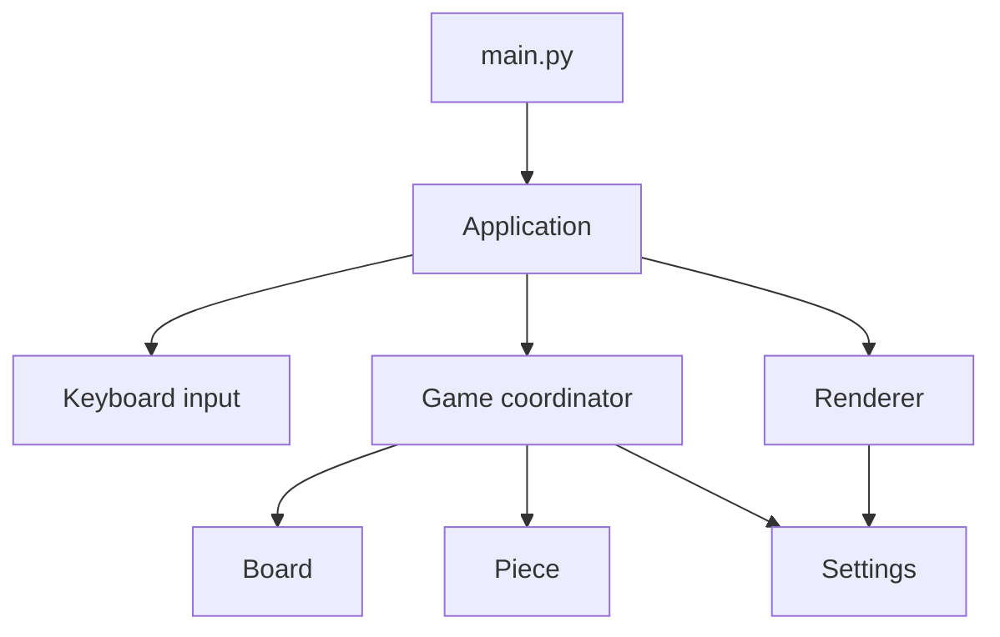
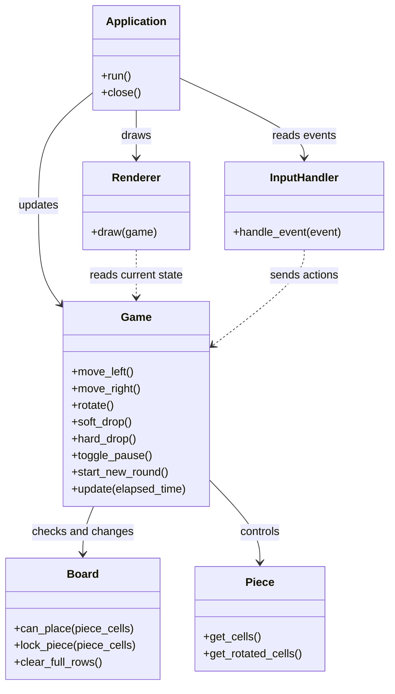
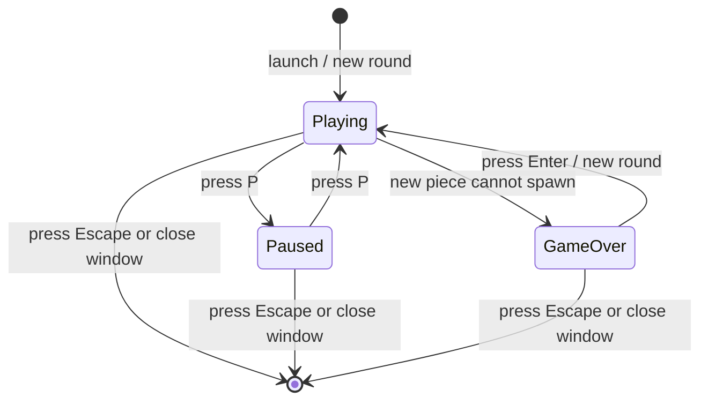
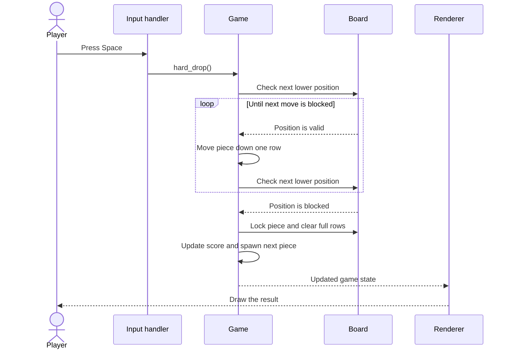
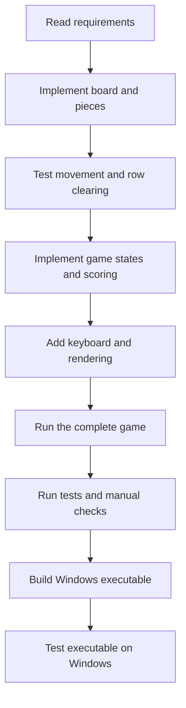

# Simple diagrams

These diagrams describe the planned design. They are deliberately small so a player, beginner or reviewer can understand them without reading the source code.

## 1. Component diagram

The application coordinates input, game rules and drawing. The game rules own the board and active piece. Drawing displays the current state but does not change it.

**In plain English:** the application listens for keyboard actions and asks the Game to update. The Renderer displays the result. Board and Piece contain game data and rules; they do not draw anything.

## 2. Simplified class diagram

The names are a guide to responsibilities, not a demand to implement every method with exactly this spelling. Keep the final design small and internally consistent.

## 3. Game-state diagram

**Important rule:** the board and gravity timer do not advance while Paused. Escape and the window close button work in every state.

## 4. Hard-drop sequence

## 5. Implementation flow

If the implementation plan changes materially, update these diagrams so they continue to match the code.
